# Clear

**A calm, private companion for your mental well-being on Android and Wear OS.**

[](https://github.com/ItsDylan255/Clear/releases/latest)


Clear helps you notice how you are doing, find support in difficult moments and collect the things that keep you grounded. Everything stays on your phone: no accounts, no cloud, no tracking and no internet connection needed.

<p align="center">
  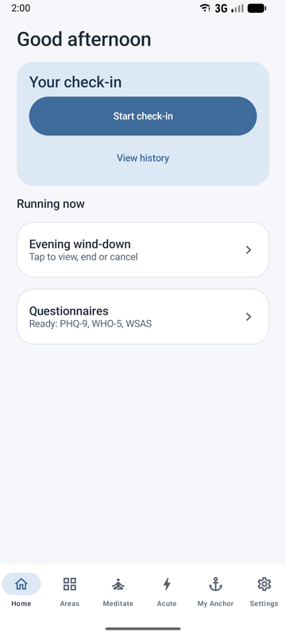
  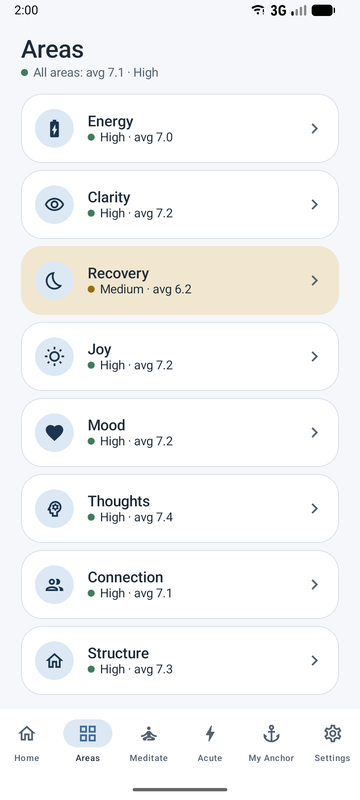
  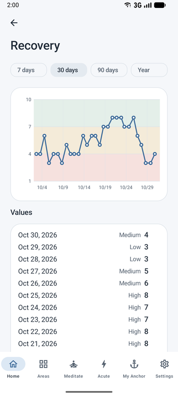
  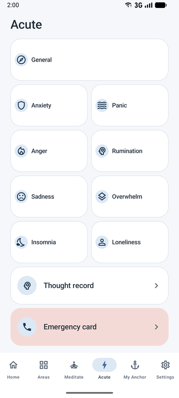
</p>

> [!IMPORTANT]
> **Clear is not a medical device and does not replace professional help.** It does not diagnose anything. If you are in crisis, please contact your local emergency number or a crisis line right away.

---

## Contents

- [Features](#features)
- [Screenshots](#screenshots)
- [Wear OS companion](#wear-os-companion)
- [Privacy](#privacy)
- [Installation](#installation)
- [Building from source](#building-from-source)
- [Tech stack](#tech-stack)
- [Project structure](#project-structure)
- [Status](#status)

## Features

### Check in
- Quick check-ins across eight areas: energy, clarity, recovery, joy, mood, thoughts, connection and structure
- History and charts for every area, over 7 days, 30 days, 90 days or a year
- Validated questionnaires, available every 14 days: **PHQ-9**, **WHO-5** and **WSAS**
- **Personal early-warning signs:** Clear compares new ratings to *your own* usual range, not to fixed thresholds, and gently points out when an area has been lower than usual for a while. A single bad day never triggers a warning.

### Ideas
- Your own ideas for each area, with a different version for high, medium and low days
- Start an idea with a short "How do you feel right now?" rating
- End it with a second rating and see how your mood changed, or **cancel it** without a rating
- Running ideas stay in a notification with *End* and *Cancel*, and optionally switch on Do Not Disturb

### Acute help
- Short, clear exercises for difficult moments, chosen by emotion: anxiety, panic, anger, rumination, sadness, overwhelm, insomnia, loneliness or a general option
- Thought records inspired by cognitive behavioral therapy (CBT)
- An emergency card with your contact person, your plan and your warning signs

### Meditate
- Ten guided meditations with a built-in player (spoken in German)

### My Anchor
- Your personal collection of things that help: quotes, images, music and letters to yourself
- An evening archive of small successes and good moments
- Optional, gentle reminders at fixed or random times

### Settings
- Appearance (light, dark or system) and language (English or German)
- Reminders and Do Not Disturb while an idea is running
- **Delete everything:** removes all data, files, reminders and settings for good

## Screenshots

<table>
  <tr>
    <td align="center">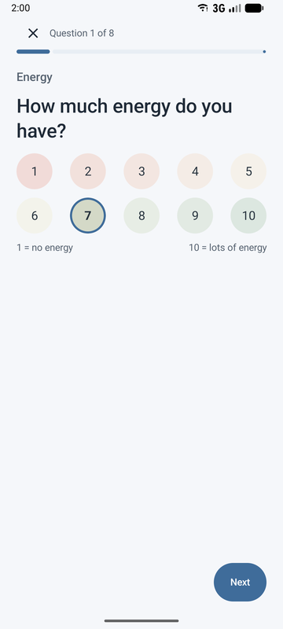<br><sub>Check-in</sub></td>
    <td align="center">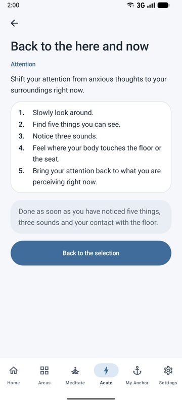<br><sub>Acute exercise</sub></td>
    <td align="center">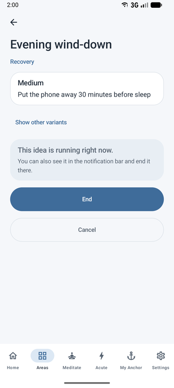<br><sub>Running idea</sub></td>
  </tr>
  <tr>
    <td align="center">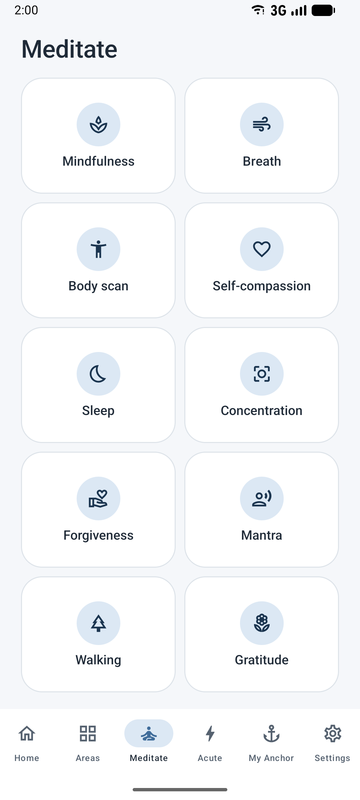<br><sub>Meditate</sub></td>
    <td align="center">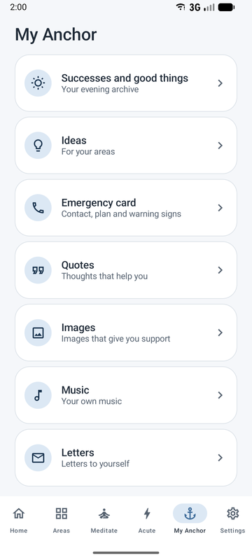<br><sub>My Anchor</sub></td>
    <td align="center">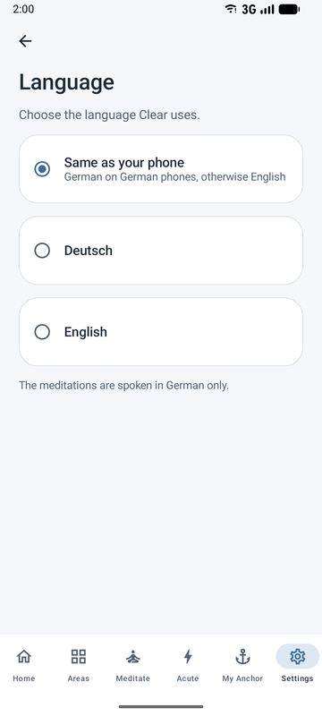<br><sub>Language</sub></td>
  </tr>
</table>

<p align="center">
  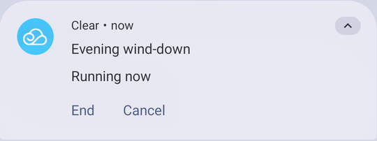<br>
  <sub>A running idea in the notification shade</sub>
</p>

## Wear OS companion

A small companion app for Wear OS watches, for example the Galaxy Watch 7:

- **Running ideas:** see which ideas are running and end one right on your wrist with the same "How do you feel now?" rating as on the phone, or cancel it without a rating. The result is saved on the phone.
- **Tile:** swipe from the watch face to see how many ideas are running and whether you have checked in today. Tap it to open the running ideas.
- The watch uses the language you set in Clear on your phone.

The watch app has no data of its own and needs the phone app. Both must come from the same release, because they have to be signed with the same key.

## Privacy

- All data is stored locally in an on-device database.
- No accounts, no analytics, no ads and no network access.
- Android cloud backup and device-to-device transfer are turned off.
- **Watch:** if you use the Wear OS app, the watch receives only the titles of running ideas, the time of your last check-in and your language setting, through Google's Wearable Data Layer. This usually goes directly over Bluetooth. When the watch is connected only through Wi-Fi or LTE, Google relays the data encrypted.

## Installation

### Phone
1. Open the [latest release](https://github.com/ItsDylan255/Clear/releases/latest) on your phone and download `Clear-v<version>.apk`.
2. Open the file and allow your browser to install apps when Android asks.
3. Tap **Install** (or **Update**; your data stays).

Requires **Android 8.0 (API 26)** or newer.

### Watch
The watch has no browser, so the app is installed with ADB over Wi-Fi:

1. Download `Clear-Wear-v<version>.apk` from the same release to your computer.
2. On the watch, open *Settings → Developer options* and turn on **ADB debugging** and **Wireless debugging**. Watch and computer must be on the same Wi-Fi.
3. Under *Wireless debugging*, tap **Pair new device** and pair once:
   ```bash
   adb pair <watch-ip>:<pairing-port> <pairing-code>
   ```
4. Connect and install:
   ```bash
   adb connect <watch-ip>:<port>
   adb -s <watch-ip>:<port> install -r Clear-Wear-v<version>.apk
   ```
5. Turn wireless debugging off again afterwards to save battery.

Requires **Wear OS 3** or newer.

## Building from source

Requirements: Android Studio (or the Android SDK) and JDK 17 or newer.

```bash
git clone https://github.com/ItsDylan255/Clear.git
cd Clear
./gradlew assembleDebug
```

This builds both apps:
- phone: `app/build/outputs/apk/debug/app-debug.apk`
- watch: `wear/build/outputs/apk/debug/wear-debug.apk`

Unit tests run with `./gradlew testDebugUnitTest`.

## Tech stack

- Kotlin and Jetpack Compose (Material 3)
- Navigation Compose, ViewModel and StateFlow
- Room as the local database, with its schema exported to `app/schemas/`
- WorkManager for reminders
- Media3 / ExoPlayer for meditations and background music
- Coil for images
- Wear OS: Compose for Wear OS, Tiles and the Wearable Data Layer

## Project structure

```
app/src/main/java/com/example/clear/
├── AppLanguage.kt  App language and the tr("Deutsch", "English") helper
├── data/           Room entities, DAOs, repositories, migrations
├── domain/         Pure logic: baseline and early-warning analysis, levels
├── model/          Static content: areas, exercises, questionnaires, meditations
├── navigation/     Routes and the app's navigation graph
├── playback/       Meditation and music playback
├── reminder/       Reminders, notifications, focus mode, foreground services
├── ui/             Compose screens for each area, shared components and theme
└── watch/          Sync with the watch (WatchSync, WatchMessageService)

wear/src/main/java/com/example/clear/wear/
├── MainActivity.kt         Running ideas, rating and cancelling
├── ClearTileService.kt     The tile
├── PhoneLink.kt            Messages to the phone app
├── DataListenerService.kt  Receives updates from the phone
└── StatusStore.kt          Last known state and language, cached on the watch
```

Every text lives in the code in both languages, for example `tr("Beenden", "End")`. `AppLanguage` decides which one is shown, so a new text is translated right where it is written.

## Status

Clear is an early version (1.1.0). Feedback and ideas are welcome in the [issues](https://github.com/ItsDylan255/Clear/issues).

The screenshots show sample data.
